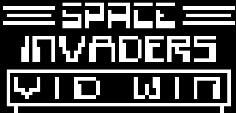

# Chip8 Emulator in C++

** Unfinished software **



This project was created in the goal of exploring how emulator works and how to simulate a full fledge CPU.

## Features

- Can read & run .ch8 games
- Emulate Chip8 gamestation
- Buffer from the CPU's instructions to a graphic pipeline

## Requirements

- clang
- C++17 or newer
- SDL2

## Build

This example assume you have `clang++` & `SDL2` installed on your machine:

```bash
make run
```
Ps: Feel free to use whatever you want to build it

## License

This project is for learning and experimentation purposes.
